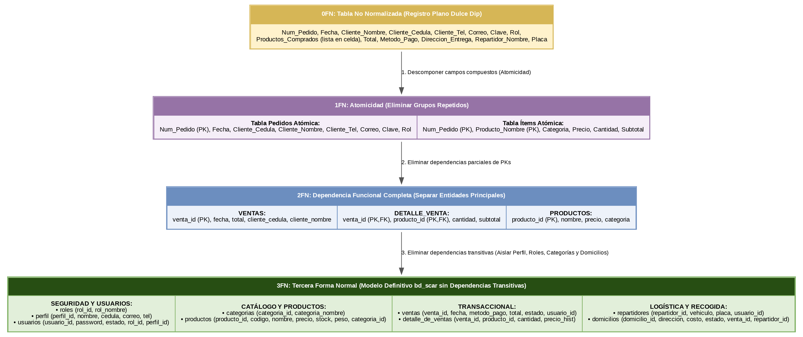

# Proceso de Normalización de la Base de Datos - Proyecto SCAR (Dulce Dip)

Este documento detalla el proceso metodológico de normalización de la base de datos `bd_scar`, transformando los registros informales y planos de la microempresa **Dulce Dip** hasta la **Tercera Forma Normal (3FN)** exigida por los estándares de ingeniería de software.

---

## 1. Estado Inicial: Forma No Normalizada (0FN)

Originalmente, los encargos de queso crema se registraban en una sola libreta/hoja de cálculo, mezclando datos de clientes, productos y entregas con grupos repetidos en una sola casilla.

### Tabla No Normalizada (0FN)
| Num_Pedido | Fecha | Cliente_Nombre | Cliente_Cedula | Cliente_Tel | Correo | Clave | Rol | Productos_Comprados | Total | Metodo_Pago | Direccion_Entrega | Repartidor_Nombre | Placa |
| :--- | :--- | :--- | :--- | :--- | :--- | :--- | :--- | :--- | :--- | :--- | :--- | :--- | :--- |
| **101** | 2026-10-25 | Neila Bello | 123456789 | 3101234567 | neila@dulcedip.com | $2y$10$... | VENDEDOR | Queso Crema Feijoa 130g (2 x $10.000), Queso Crema Café 230g (1 x $20.000) | $40.000 | Nequi | Recogida en Punto de Venta | N/A | N/A |

---

## 2. Primera Forma Normal (1FN) - Atomicidad

**Regla aplicada:** Se eliminan los grupos repetidos en una misma celda (`Productos_Comprados`). Cada campo contiene valores atómicos e indivisibles.

### Tabla 1FN: Registro Atómico de Pedidos e Ítems
| Num_Pedido (PK) | Fecha | Cliente_Cedula | Cliente_Nombre | Producto_Nombre (PK) | Categoria | Cantidad | Precio_Unitario | Subtotal | Total_Pedido |
| :--- | :--- | :--- | :--- | :--- | :--- | :--- | :--- | :--- | :--- |
| **101** | 2026-10-25 | 123456789 | Neila Bello | Queso Crema Feijoa 130g | Queso Crema 130g | 2 | $10.000 | $20.000 | $40.000 |
| **101** | 2026-10-25 | 123456789 | Neila Bello | Queso Crema Café 230g | Queso Crema 230g | 1 | $20.000 | $20.000 | $40.000 |

---

## 3. Segunda Forma Normal (2FN) - Dependencia Funcional Completa

**Regla aplicada:** Se eliminan las dependencias parciales. Todos los atributos no clave dependen totalmente de la clave primaria. Se separan las entidades **VENTAS**, **PRODUCTOS** y la tabla de ruptura **DETALLE_DE_VENTAS**.

### Tablas en 2FN
* **`VENTAS`**: `(venta_id [PK], fecha, total, cliente_cedula, cliente_nombre)`
* **`PRODUCTOS`**: `(producto_id [PK], producto_nombre, producto_precio, categoria)`
* **`DETALLE_DE_VENTAS`**: `(VENTAS_venta_id [PK,FK], PRODUCTOS_producto_id [PK,FK], detalle_cantidad, detalle_subtotal)`

---

## 4. Tercera Forma Normal (3FN) - Eliminación de Dependencias Transitivas

**Regla aplicada:** Se eliminan las dependencias transitivas (ningún atributo no clave depende de otro atributo no clave).

### Justificación de Desacoplamientos en 3FN:
1. **Aisle de Perfil y Usuarios:** Se separa la tabla `perfil` (nombres, cédula, teléfono) de `usuarios` (password, estado) para evitar redundancias de datos personales.
2. **Normalización de Roles:** Los permisos se gestionan de forma centralizada en la tabla `roles`.
3. **Control de Categorías:** Se independizan las presentaciones (130g y 230g) en la tabla `categorias`.
4. **Logística y Despacho:** La gestión de la recogida o domicilio se extrae a la tabla `domicilios` (relación 1:1 con `ventas`), vinculando de forma opcional a `repartidores`.

### Estructura Definitiva de Tablas en 3FN (`bd_scar`):
1. **`roles`** (`rol_id`, `rol_nombre`)
2. **`perfil`** (`perfil_id`, `nombre`, `apellido`, `cedula`, `correo`, `telefono`, `direccion`, `foto`)
3. **`usuarios`** (`usuario_id`, `correo_recuperacion`, `password`, `estado`, `ROLES_rol_id`, `PERFIL_perfil_id`)
4. **`categorias`** (`categoria_id`, `categoria_nombre`)
5. **`productos`** (`producto_id`, `producto_codigo`, `producto_nombre`, `producto_precio`, `producto_stock`, `producto_peso`, `CATEGORIAS_categoria_id`)
6. **`repartidores`** (`repartidor_id`, `vehiculo`, `placa`, `repartidor_estado`, `USUARIOS_usuario_id`)
7. **`ventas`** (`venta_id`, `venta_fecha`, `venta_metodo_pago`, `venta_total`, `venta_estado`, `USUARIOS_usuario_id`)
8. **`detalle_de_ventas`** (`VENTAS_venta_id`, `PRODUCTOS_producto_id`, `detalle_cantidad`, `detalle_precio_historico`, `detalle_subtotal`)
9. **`domicilios`** (`domicilio_id`, `domicilio_direccion`, `domicilio_costo_envio`, `domicilio_estado`, `VENTAS_venta_id`, `REPARTIDORES_repartidor_id`)

---

## Diagrama Esquemático de Normalización

